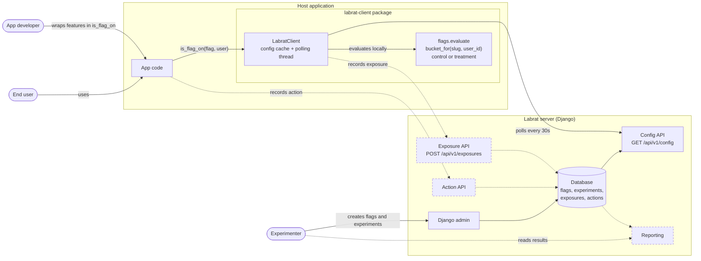

# Labrat - an experimental experimentations platform

> [!important]
>This is a work in progress.

**NOTE:** This repo contains a Django project and a separate python package
(labrat-client). To get all dependencies run `uv sync --all-packages`

## Planning

### MVP Scope

Experimentation has decent amount of depth, but here we are going to focus on the primary facets of it:

**Progress**

1. [x] List of experiments / feature flags
2. [x] Assignment algorithm - changing to key on experiment slug
3. [x] Basic code interface
    * [x] check if flag is on
    * [x] fetch flag/experiment config
4. [ ] Exposure log
    * [ ] back-end
    * [ ] client
5. [ ] Action log
    * [ ] back-end
    * [ ] client
6. [ ] Reporting / significance testing
7. [ ] Data generator (to test reporting and quickly make interesting data for a UI)

### After MVP

* Expand experiment capabilities
  * End after # of samples, time is really just a proxy for that.
  * Allow additional variants (A/B/n)
  * Guardrail metrics (requires the system has awareness of real-time metrics)
  * Ramp-up (release experiment to an increasing % of subjects growing at a cadence)
* Build a single contract to enforce server/client data consistency
  1. Shared `labrat-core` workspace package (no dependencies) holding the `Variant` enum, bucketing, and payload
     shapes. Server and client both depend on it, rather than the server depending on `labrat-client`.
  2. Server sends variant names/weights in the config snapshot, making it the runtime source of truth (pairs with A/B/n
     variants). `labrat-core` keeps only the hashing algorithm.
  3. Shared test vectors (`(slug, subject) -> bucket` fixtures) that every client implementation must pass, enabling
     non-Python SDKs.
* Add an MCP server to allow agents to interact with experiments / data sets
* Convert to PostgreSQL
    * Add additional constraints to data (tstzrange on start/end)
* Authentication (multitenancy)
* Batch send exposures? (scalability)
* JavaScript SDK? (scalability)
* Read external data (hook into reporting)?
    * Google Analytics
    * Hotjar
    * ...
* Data export?
* History tables (observability)
    * Experiments
    * FeatureFlags

### Database design

* Feature Flags
    * id
    * name (unique)
    * enabled
* Experiments
    * id
    * feature_flag_id
    * name
    * slug (unique)
    * hypothesis
    * control
    * treatment
    * start_at
    * end_at

### Assignment algorithm

Bucket = (int) hashlib.sha256 (experiment.slug + ":" + user_id) % 100;

### Client

* Fetch config
    * For this version, will use polling, but at scale pub/sub and/or config caching is needed.
* Check which flags are enabled: `if labrat.is_flag_on(flag_name) ...`
    * If no experiment active: = feature flag enabled state
    * If experiment active: = use assignment algorithm with experiment config for result

### Exposure log

In this case, we can log an exposure in the block immediately after the feature flag check:
`if labrat.is_flag_on(flag_name) labrat.record_exposure(experiment, user)`

This is rudimentary, if the feature flag or experiment contains parameters or other variants, we'd need to record the
active variant as well. It would be possible that the active variant and parameters could be derived later, this would
add burden to the reporting platform where normalized data storage is harder to query. Having de-normalized data storage
provides an easier and faster query surface for data aggregation.

Exposure Table:

* id
* created_at
* experiment_id
* subject
* variant
* exposed_at

**Exposure API fields**

* exposed_at
* experiment_id (slug?)
* subject_id
* variant

**Validation:**

There is a chance that bad data can come in from a client due to out-of-date configuration caches. We can add some basic
validations to the received exposures to help understand what is good/bad and why.

* Compute expected exposure for a given flag at a specific time with specific subject.
* If expected exposure doesn't match given exposure, flag given exposure as invalid
* Record exposure + with audit field, `created_at`

### Action log

Triggered somewhere else, maybe front-end or back-end code handlers for a button click.
`labrat.record_action(user, action)`

Action Table:

* id
* created_at
* subject
* action

### Reporting

* Conversion rate
* Significance test

# Considerations

* I've envisioned this framework as a centralized experiment store with individual apps reaching out to it via API to
  log exposures and actions. However, this has downsides in that all experimentation features must be implemented
  centrally which adds the complexity of a multi-tenant application. Another approach would be to build the
  experimentation platform as a Django plugin so that it can be reused in different applications and extended there as
  needed. This solves some problems, but gains other considerations like an extensibility surface, and complexities
  around version updates to an extended system.
* Academically, having tables for exposures and actions is convenient. However, there is a good chance that reality
  would dictate other needs. Likely applications are using their own tracking platforms like hotjar, or google analytics
  that allow them to track custom fields / metrics across page loads. It may be desired to hook exposures and metrics
  into external data apis or data warehouses in order to reduce the integration burden and redundancy on other product
  teams.
