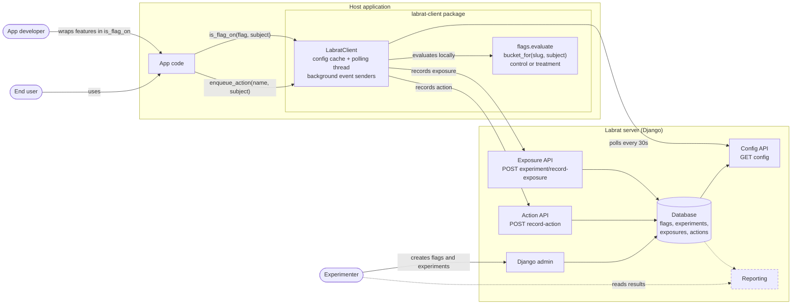

# Labrat - an experimental experimentations platform

A feature-flag and A/B testing platform: a Django server that stores flags, experiments, and events, and a Python client
package that evaluates flags locally and reports exposures and actions in the background.

> [!important]
> This is a work in progress. Flags, experiments, assignment, and exposure and action logging work end-to-end today.
> Reporting hasn't been started yet. See [Status](#status).

## Why this exists

Labrat is a learning project with three goals:

1. **Python.** Write idiomatic, typed, tested Python, including concurrency in the client library.
2. **Django.** Learn the framework by using its core pieces (models, validation, forms, admin, ORM) without reaching
   for extra libraries.
3. **Experimentation.** Learn how experimentation platforms work: how users are assigned to variants, how to analyze
   the data, and how to present findings.

Because of that, I've made some choices to favor learning over other considerations (SQLite, no auth,
polling instead of push, limited reliance on coding assistants). These are called out where relevant.

## Architecture



Dashed items are planned. All API paths are under `/experimentation/api/v1/`.

## Usage

```python
from labrat_client import LabratClient

# Or set the LABRAT_URL environment variable.
client = LabratClient(base_url="http://localhost:8000/experimentation/api/v1")

if client.is_flag_on("new-checkout", subject="user-42"):
    ...  # An exposure is recorded automatically if an experiment is running.

client.enqueue_action(action_name="purchase", subject="user-42")

client.close()  # flushes queued events on shutdown
```

* `is_flag_on` returns `default` (`False` unless you pass one) until the first config fetch succeeds, and for flags
  that haven't been configured on the server (with a `LabratWarning`).
* The first call blocks for up to ~1 second while it fetches config. After that, flags are evaluated from a local
  cache that a background thread refreshes every 30 seconds.

## How it works

### Flags and experiments

A **feature flag** is a named on/off switch. An **experiment** is attached to a flag for a time window and splits
subjects between **control** and **treatment** by percentage (the two must sum to 100).

* No experiment running: everyone gets the feature flag's `enabled` value.
* Experiment running: control gets the feature flag's `enabled` value and treatment gets the opposite. The feature
  flag's current state is the baseline and the experiment tests flipping it.

### Assignment

```
bucket  = int(first 8 bytes of sha256(f"{experiment_slug}:{subject}"), big-endian) % 100
variant = "control" if bucket < control_percent else "treatment"
```

### Exposures

An exposure records that a subject actually saw a variant of a running experiment. The client sends one automatically
the first time `is_flag_on` evaluates a running experiment for a given subject (deduplicated per client instance). The
server validates the exposure data before storing it.

### Actions

An action is something a subject did (e.g. `purchase`) with a timestamp. Reporting will join actions to exposures by
subject and time to compute conversion rates per variant.

## Design decisions

* **Assignment is a deterministic hash, evaluated not stored.** Hashing the experiment slug and subject means no
assignment table, no network calls, and the same answer in every process / server. The challenge is
that every client implementation (though only a python client for now) must reproduce the algorithm exactly.
A shared contract for that is on the roadmap.
* **The hash is keyed on the experiment.** If the bucket were keyed only on the subject, the same users would
land in treatment for every experiment; if it were keyed on the flag, the same users would land in the same group for
all experiments on that flag. That would make results from different experiments correlated. Including the
experiment slug gives each experiment an independent assignment.
* **Exposures are logged at the flag check.** I'm assuming that if you're checking a flag's state, you're deciding
to display content based on the result. That means we can assume an exposure when you check. There may be some instances
where additional application logic really determines whether to expose a flag, but that can come post MVP.
* **Exposures are deduplicated in the client AND the db.** While I could only deduplicate in the DB, deduplicating at
the client has the potential to save a lot of junk data from entering the database. Reporting will only care about the
first exposure time for a given subject, so we don't need to track _every_ exposure. This doesn't guarantee a single
exposure per experiment / subject though, so we'll need deduplication in the DB at reporting time.
* **Experiments are locked once they start.** After `start_at`, only the name can be edited (enforced in the model's
`clean()` and reflected in the admin). Changing the split or dates mid-experiment would mean earlier and later subjects
were treated under different rules, which invalidates the comparison.
* **One experiment per flag at a time.** Overlapping experiments on the same flag are rejected, so every exposure belongs
to exactly one experiment and effects can't be attributed to the wrong one.
* **The server validates exposures instead of trusting the client.** A client with a stale config cache can report the
wrong variant or report outside the experiment window. The server recomputes the expected variant and checks the window,
and rejects mismatches with a `422`. Rejected exposures are currently dropped. Storing them flagged as invalid would
make the data quality issue measurable instead of invisible, and is still an open question.
* **Event sending never blocks the host app.** Exposures and actions go into queues drained by background
threads. If a queue fills due to something like a slow server, events are dropped and counted (with one warning
when dropping starts and one when it recovers) rather than interfering with the host application.
* **Plain Django forms validate the JSON API.** The API is three endpoints, and learning core Django is a primary goal.
Forms provide field validation and structured errors, so they fit the mold pretty well. I use a custom field
(`AwareDateTimeField`) to reject timestamps without a timezone. Errors use a consistent
`{"errors": {...}}` envelope, with `400` for malformed JSON and `422` for invalid data.
* **Data stays denormalized for analysis.** Exposures store their variant instead of deriving it later. This adds some
redundancy, but will simplify reporting queries later.

### Considerations

* I've envisioned this framework as a centralized experiment store with individual apps reaching out to it via API to
  log exposures and actions. However, this has downsides in that all experimentation features must be implemented
  centrally which adds the complexity of a multi-tenant application. Another approach would be to build the
  experimentation platform as a Django plugin so that it can be reused in different applications and extended there as
  needed. This solves some problems, but gains other considerations like an extensibility surface, and complexities
  around version updates to an extended system.
* Academically, having tables for exposures and actions is convenient. However, there is a good chance that reality
  would dictate other needs. Likely applications are using their own tracking platforms like Hotjar, or Google Analytics
  that allow them to track custom fields / actions / metrics across page loads. It may be desired to build connectors
  to integrate Labrat with external analytics platforms or data warehouses in order to reduce the integration burden
  and redundancy on other product teams.

## Status

1. [x] Feature flags and experiments (models, validation, admin)
2. [x] Assignment algorithm
3. [x] Client: flag evaluation with a cached, polled config
4. [x] Exposure log
    * [x] back-end
    * [x] client
5. [x] Action log
    * [x] back-end
    * [x] client
6. [ ] Data generator (to test reporting and quickly make interesting data for a UI)
7. [ ] Reporting / significance testing

### After MVP

* Expand experiment capabilities
    * End after # of samples, time is really just a proxy for that.
    * Allow additional variants (A/B/n)
    * Guardrail metrics (requires the system has awareness of real-time metrics)
    * Ramp-up (release experiment to an increasing % of subjects growing at a cadence)
    * Sample ratio mismatch (SRM) checks on exposures
* Build a single contract to enforce server/client data consistency
    1. Shared `labrat-core` workspace package (no dependencies) holding the `Variant` enum, bucketing, and payload
       shapes. Server and client both depend on it, rather than the server depending on `labrat-client`.
    2. Server sends variant names/weights in the config snapshot, making it the runtime source of truth (pairs with
       A/B/n variants). `labrat-core` keeps only the hashing algorithm.
    3. Shared test vectors (`(slug, subject) -> bucket` fixtures) that every client implementation must pass, enabling
       non-Python SDKs.
* Add an MCP server to allow agents to interact with experiments / data sets
* Convert to PostgreSQL
    * Add additional constraints to data (tstzrange on start/end)
* Authentication (multitenancy)
* Retry with backoff when sending events
* Batch send exposures? (scalability)
* Push config updates instead of polling (scalability)
* JavaScript SDK? (scalability)
* Read external data (hook into reporting)?
    * Google Analytics
    * Hotjar
    * ...
* Data export?
* History tables (observability)
    * Experiments
    * FeatureFlags

## Development

This repo is a [uv workspace](https://docs.astral.sh/uv/concepts/projects/workspaces/) containing the Django project
and a separately installable client package (`packages/labrat-client`).

```sh
uv sync --all-packages          # install all dependencies
uv run manage.py migrate
uv run manage.py createsuperuser
uv run manage.py runserver      # admin at http://localhost:8000/admin/

./precommit.sh                  # the same checks CI runs: ruff, ruff format, pyrefly, pytest
```

Tests include unit tests for both packages and an integration test that runs the real client against a live Django
server.
